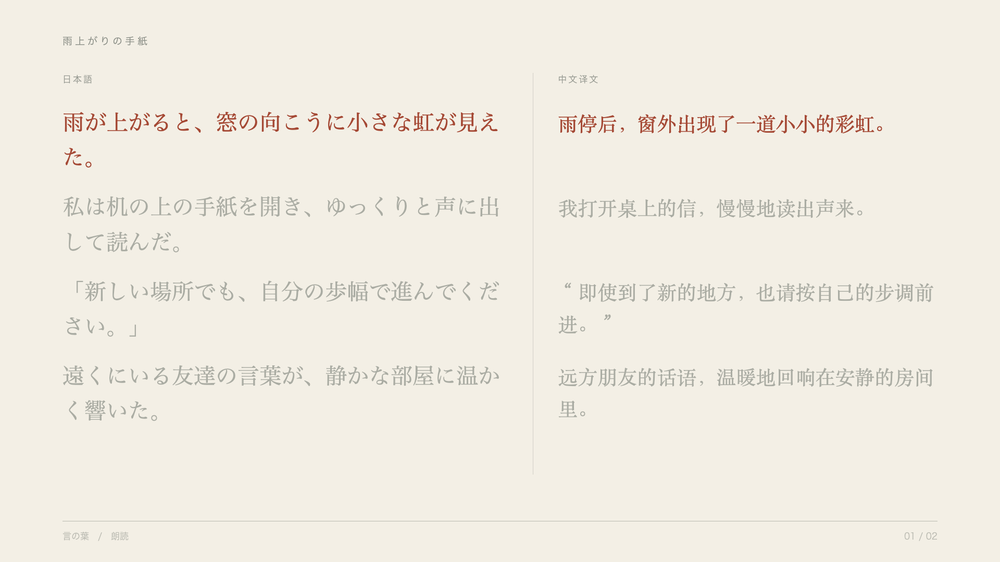

# 言の葉 · Kotonoha Studio

[中文](README.zh-CN.md) · [Architecture](docs/architecture.md) · [Evaluation](docs/evaluation.md) · [Testing](docs/testing.md)

日本語の文章と朗読音声から、ふりがな・中国語訳・文ごとのハイライトを備えた動画を制作するローカル Web アプリです。React / TypeScript / Remotion を中心に、翻訳と音声同期のローカルモデルを組み込み、生成結果を確認・修正してから反映できます。

## 動画画面の例




プロジェクト用に作成したオリジナル短文「雨上がりの手紙」を使用しています。画像は動画の出力例で、編集画面のスクリーンショットではありません。デモ訳文は手動編集済みの例です。

## 機能

- 日本語の縦書き、禁則処理、容量に合わせたページ分け。
- 日中対訳の横書き、文ごとの対応と同期ハイライト。
- Kuroshiro / Kuromoji / JMdict によるふりがなと、保持される手動修正。
- ローカル翻訳の生成、逐文レビュー、選択反映、取消と古い結果の上書き防止。
- 既知の本文と朗読の時刻合わせ、波形と手動編集、時刻ロック。
- 音声増幅・ピーク制限、1920×1080 / 30 fps / H.264 + AAC の MP4 出力。
- 音声を含む IndexedDB 保存と再読み込み、JSON バックアップ。
- 日本語 / 中文の UI。初期表示は日本語です。

## 起動

基本編集の動作確認は macOS / Apple Silicon / Node.js 22 で行っています。AI 機能は Apple Silicon と追加セットアップが必要です。

```sh
npm ci
npm run dev
```

http://127.0.0.1:5173 を開きます。API は 3001 番ポートを使います。`start.command` でも起動できますが、Node.js は別途インストールしてください。

最初の編集・プレビュー・保存に ML モデルは不要です。`samples/demo.kotonoha.json` は中国語訳付きの公開デモで、音声は含みません。自分の MP3 / WAV / M4A を読み込んでください。

書き出しには Chrome を使用します。Chrome がない場合、Remotion が初回にブラウザーをダウンロードします。音声増幅には完全版 FFmpeg が必要です。

```sh
brew install ffmpeg
```

## オプションの AI / 辞書機能

| 機能 | 準備 | 実行環境 |
| --- | --- | --- |
| ふりがな | `npm run setup:furigana` | 初回に JMdict を取得 |
| 日中翻訳 | `npm run setup:translation` | Apple Silicon、Hy-MT2 1.8B MLX 4-bit、約 1.02 GB |
| 音声同期 | `npm run setup:alignment` | Apple Silicon / macOS 15+、Qwen3-ForcedAligner 0.6B MLX 8-bit、約 1.3 GB |

Python 環境の準備には uv を使います。必要に応じて `brew install uv` を実行してください。初回は Python と依存関係の追加ダウンロードも発生します。モデル・辞書の準備後、推論は本機で実行されます。モデルの重みはリポジトリに含めません。

## 設計上のポイント

文 ID・本文・現在の訳文を照合してから候補を反映します。生成中に編集された内容は古い結果で上書きしません。ふりがなは「辞書一致・自動推定・手動確認済み」を区別し、未解決の読みは要確認にします。ジョブには進捗・中止・タイムアウトがあり、プロジェクトは単一トランザクションで保存します。

詳しくは [アーキテクチャ](docs/architecture.md) と [モデル選択・評価範囲](docs/evaluation.md) を参照してください。

## テスト

```sh
npm test
npm run verify:locale
npm run verify:playback-page
npm run verify:storage
npm run build
```

GitHub Actions でモデル不要のチェックを実行します。実際のモデル推論・MP4 音声検証は [Testing](docs/testing.md) の別コマンドで行います。単体テストの通過を翻訳品質のスコアとして扱いません。

## 現在の制約

翻訳・読み・音声同期は人工確認を前提とします。長い文は分割や文字サイズ調整が必要です。書き出しは CPU の逐フレーム処理で時間がかかります。ローカル保存はブラウザーと URL ごとに分かれ、サイトデータの削除で失われます。サーバー再起動後に実行中のジョブは復元しません。GitHub Pages だけでは Python / Express / FFmpeg を含む全機能は動きません。

## 素材と開発

公開デモは本プロジェクト用の短文です。個人の録音・作品ファイル・モデル・実験キャッシュは Git 対象から除外しています。AI 支援ツールを使って開発しており、既存モデルの学習や独自モデルの精度は主張しません。検証範囲と制約を文書化しています。

[第三者ライセンスとデータ出典](THIRD_PARTY_NOTICES.md) を参照してください。Remotion、辞書、モデルにはそれぞれのライセンスが適用されます。
