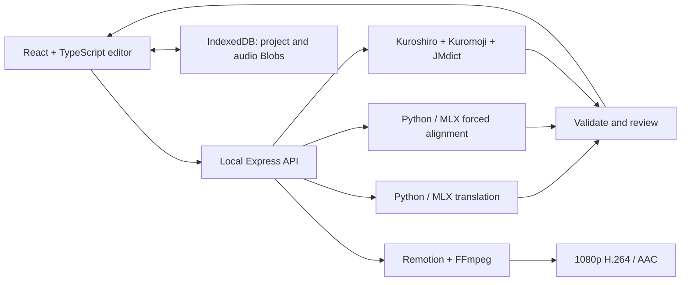

# Architecture

Kotonoha is a local-first Japanese reading-video editor. AI outputs are editable proposals; project data remains the source of truth.

## Project model

`src/model.ts` owns the versioned project schema, sentence IDs, page membership, styling and timing rules. Each translation and furigana record belongs to a particular sentence. Page-turn times are independent of speech end times. Highlighting continues until the next sentence begins.

`Video.tsx` is shared by the live player and export composition. Vertical ruby layout and bilingual row layout share their pagination geometry with validation. Switching layout retains each mode's page boundaries where valid.

## AI boundary

The browser submits an immutable snapshot to the local API. Python workers emit JSON Lines for progress and results. TypeScript validates the result count, sentence IDs and payload before offering it for review. Translation application checks the current source text and previous translation; stale output cannot overwrite subsequent edits. Manual furigana corrections and locked timings survive regeneration.

Each model service permits one active job. Cancellation terminates the worker process group; timeouts return an error while retaining existing project data. This MVP keeps jobs in process memory, so restarting the API loses in-flight jobs.

## Persistence

IndexedDB stores one current snapshot in a single transaction. Audio is stored as binary Blobs, while the editor and portable JSON files use data URLs. A successful save is reported after transaction completion. A snapshot token keeps edits made during a save marked dirty. UI language is a separate, small browser preference.

## Audio and export

Above 100% voice gain, complete FFmpeg applies amplification and a look-ahead limiter with latency compensation. Preview and export use the same processing helper. Original audio and gain are saved; processed preview audio is temporary. MP4 rendering uses a local Chrome and CPU H.264 encoding with two concurrent frame renderers.

## Scope

There is no cloud account, hosted model service or production deployment in this repository. The server listens on loopback. MLX models target Apple Silicon; basic test/build CI does not execute those models. Legacy transcription data validators remain to preserve older project files; they are not a current transcription UI.
